# Meshtastic-FIDO — демонстрация интерфейса

Децентрализованная оффлайн-сеть эхоконференций (в духе Fidonet/GoldED) поверх Meshtastic (LoRa).
Ниже — последовательность скриншотов реального прохождения: от первого запуска до чтения дерева переписки в эхоконференции.

---

### 1. Мастер первичной настройки — данные пользователя и выбор устройства

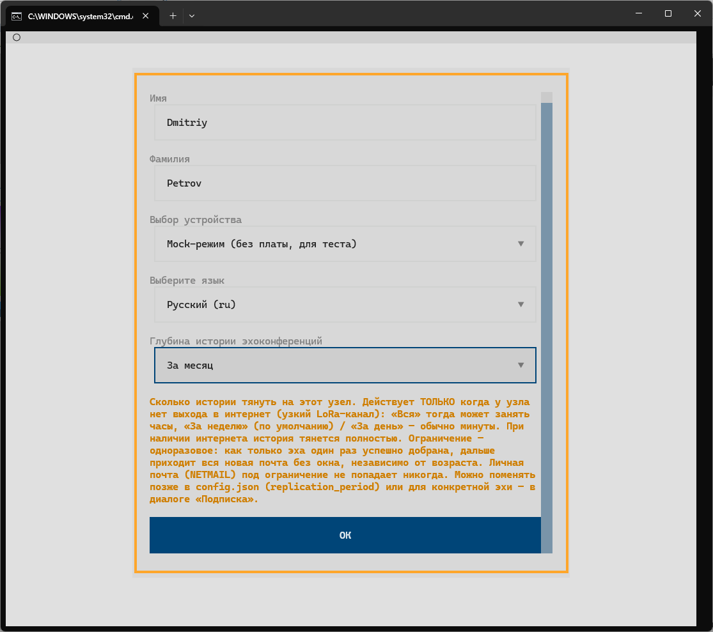

Первый экран при запуске программы: ввод имени/фамилии, выбор устройства (по умолчанию — `Mock-режим`, без платы, для тестирования) и языка интерфейса. Ниже — «Глубина истории эхоконференций»: сколько старой почты тянуть на узел, у которого нет выхода в интернет (`Вся` / `За месяц` / `За неделю` / `За день`). Ограничение одноразовое — как только эха один раз успешно добрана, дальше приходит вся новая почта; личная почта (`NETMAIL`) под ограничение не попадает. Значение можно поменять позже в `config.json` (`replication_period`) или для конкретной эхи — в диалоге «Подписка».

### 2. Выбор способа подключения к плате

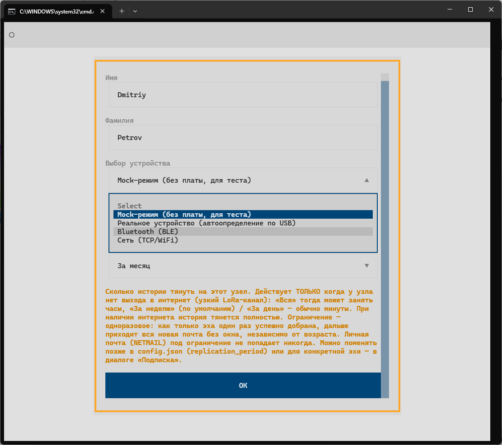

Раскрытый список доступных способов подключения: `Mock-режим` (без платы, для теста), `Реальное устройство` (автоопределение по USB), `Bluetooth (BLE)` и `Сеть (TCP/WiFi)`.

### 3. Подключение к плате по Bluetooth (BLE)

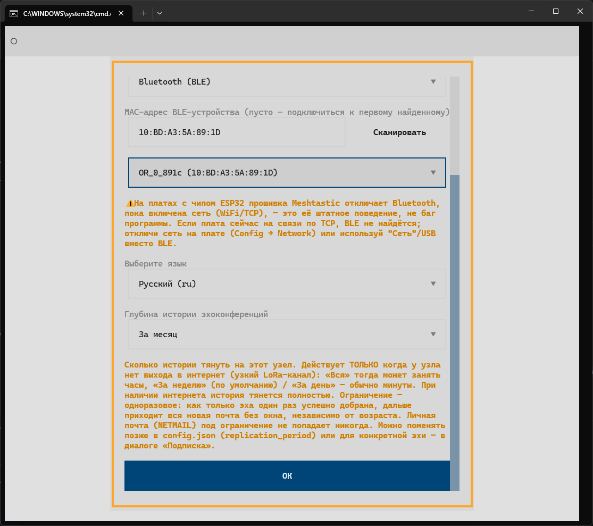

Тот же мастер с выбранным способом подключения `Bluetooth (BLE)`: сканирование эфира, найденная плата `OR_0_891c` по MAC-адресу и предупреждение о том, что на платах с чипом ESP32 прошивка Meshtastic отключает Bluetooth, пока включена сеть (WiFi/TCP) — это штатное поведение платы, а не баг программы.

### 4. Политика сети — принятие правил перед входом

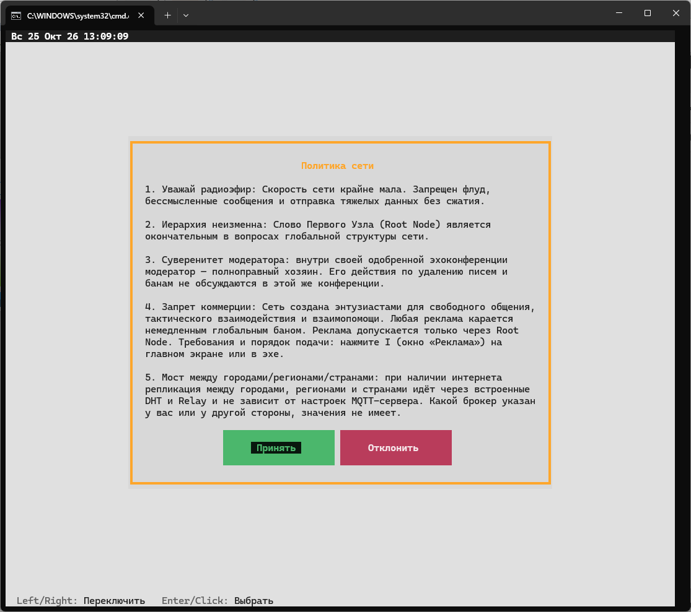

Перед входом в сеть пользователь видит и подтверждает политику сети: уважение к радиоэфиру, неизменность иерархии Root Node, суверенитет модератора внутри своей эхоконференции, запрет коммерции (реклама допускается только через Root Node; порядок подачи — клавиша `I`) и мост между городами, регионами и странами: при наличии интернета репликация идёт через встроенные DHT и Relay и не зависит от настроек MQTT-сервера. Вместе с политикой принимается и Лицензия проекта (её текст — в конце окна).

### 5. Главный экран — список областей

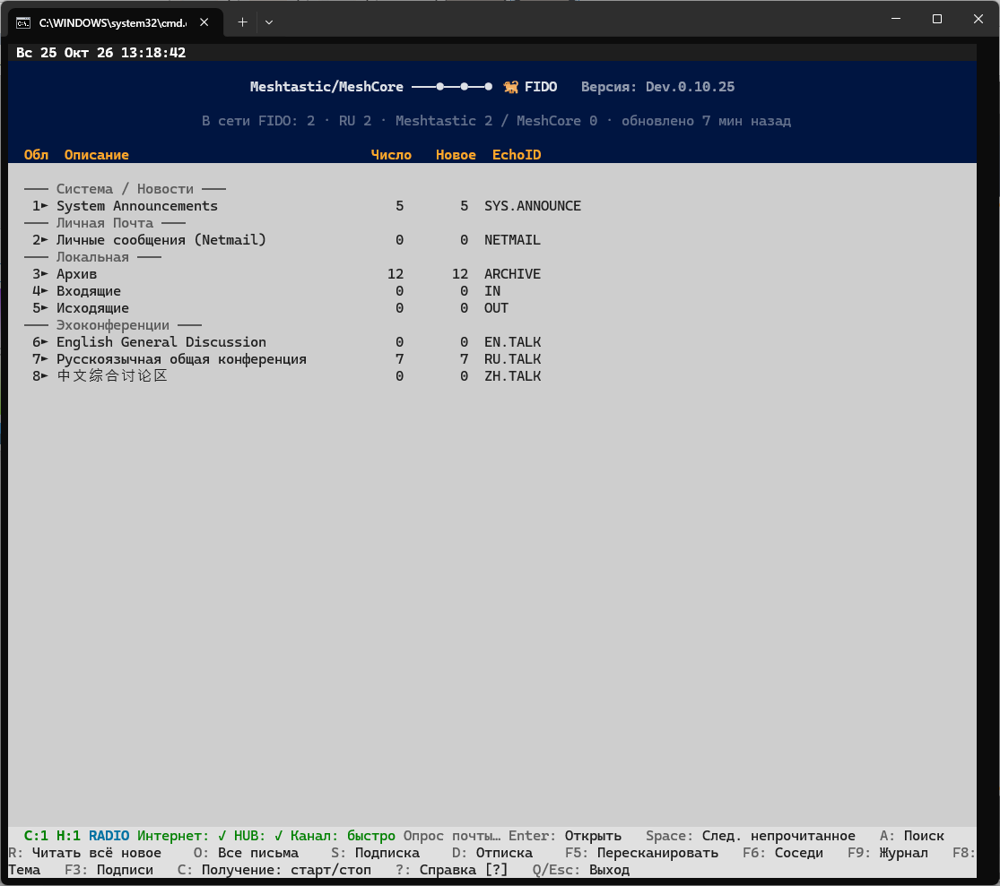
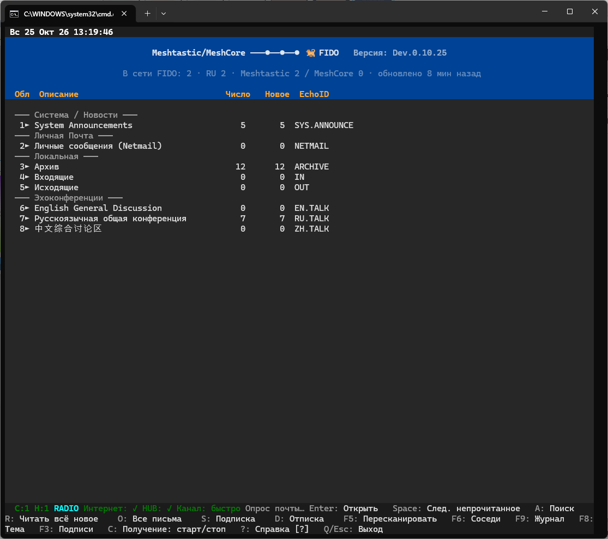

Главный экран приложения в стиле GoldED: служебная область `SYS.ANNOUNCE`, личная почта (`NETMAIL`), локальные папки (`ARCHIVE`/`IN`/`OUT`) и стартовый набор эхоконференций (`EN.TALK`, `RU.TALK`, `ZH.TALK`). Под заголовком — сводка сети («В сети FIDO: 2 · RU 2 · Meshtastic 2 / MeshCore 0 · обновлено 7 мин назад»), в нижней строке — живой статус: `C:1 H:1` (клиенты/хабы рядом), `RADIO`, `Интернет: ✓`, `HUB: ✓`, `Канал: быстро`, а ниже — подсказки по клавишам. Второй скриншот — тот же экран после переключения светлой темы на тёмную (клавиша `F8`).

### 6. Быстрый поиск эхоконференции (A)

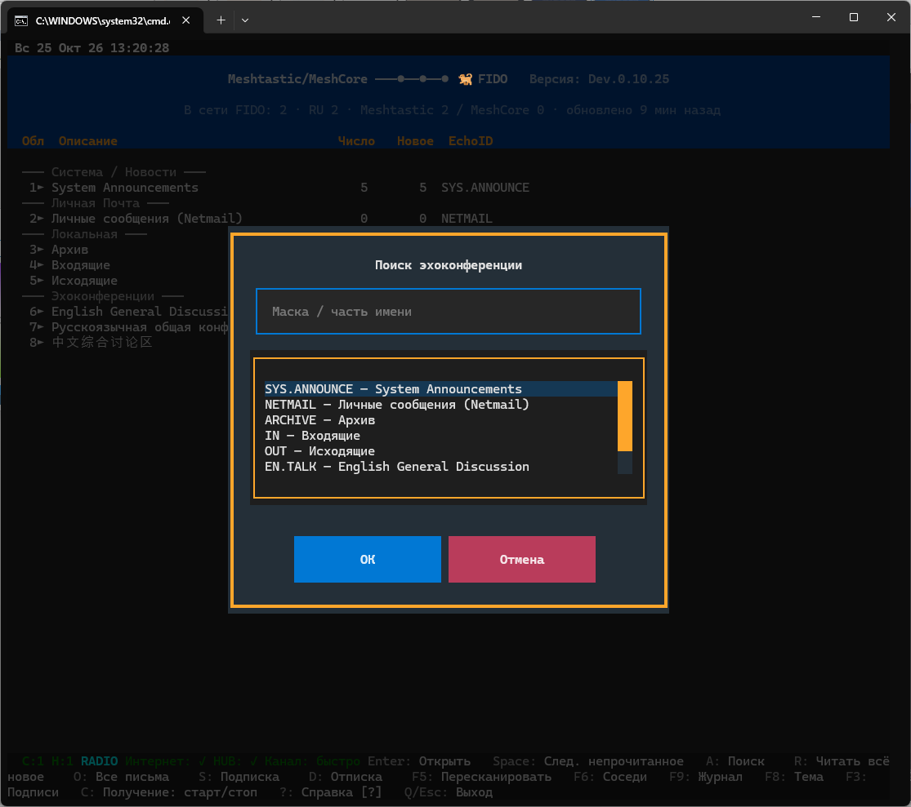

Клавиша `A` (или `Alt+A`) открывает быстрый поиск области по названию или маске: список сужается по мере ввода, `OK` переходит в выбранную область.

### 7. Подписи — tagline (F3)

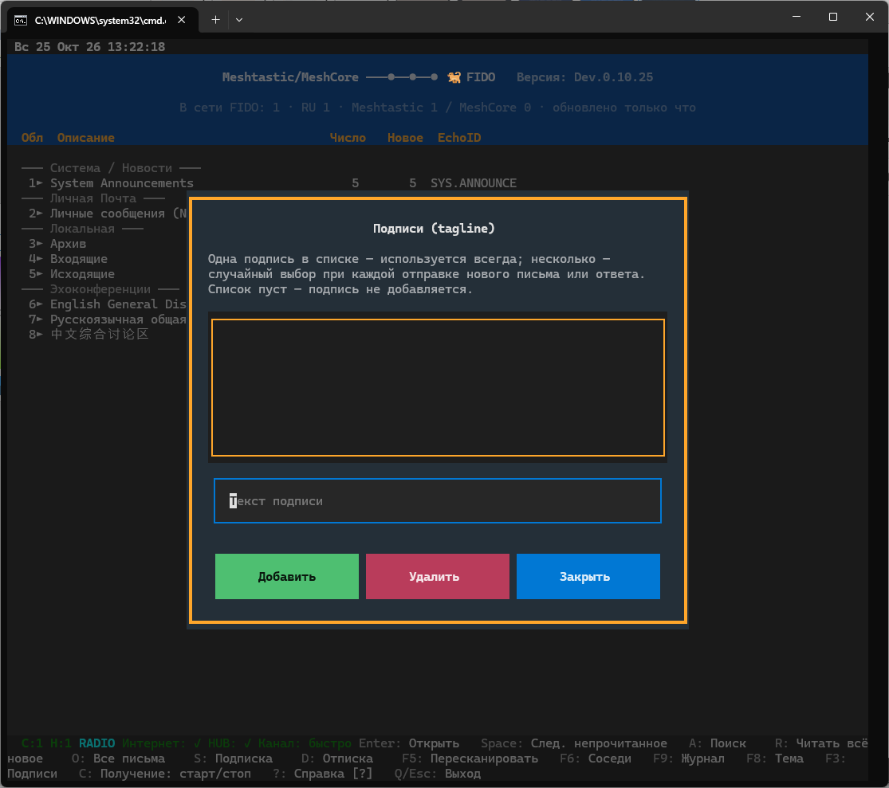

Клавиша `F3` — подписи, которые добавляются в конец новых писем и ответов. Одна подпись в списке используется всегда; если их несколько — выбирается случайная при каждой отправке. Пустой список — подпись не добавляется.

### 8. Подписка на эхоконференцию (S)

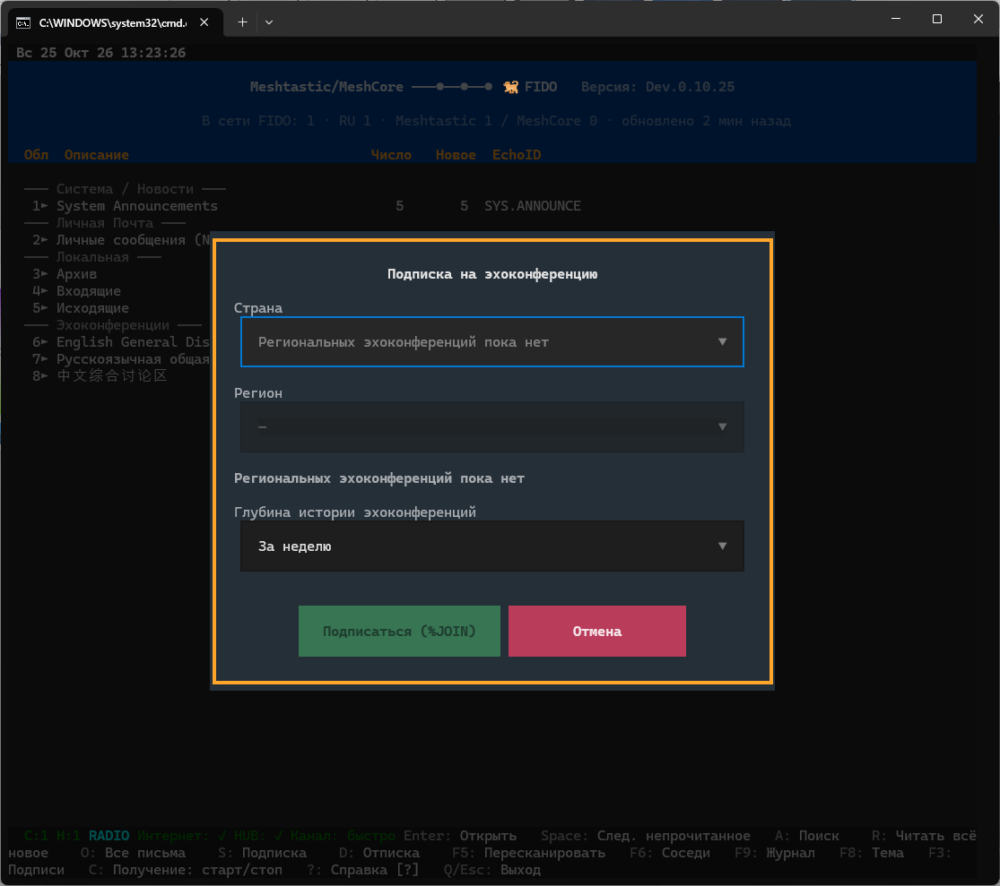

Клавиша `S` — подписка на эхоконференцию из общего каталога по стране и региону, с выбором глубины истории для этой эхи. Кнопка «Подписаться (%JOIN)» отправляет запрос хабу (отписка — клавиша `D`, `%LEAVE`). На скриншоте региональных эх в каталоге пока нет — доступны только базовые `RU/EN/ZH.TALK`.

### 9. Список соседних узлов (F6)

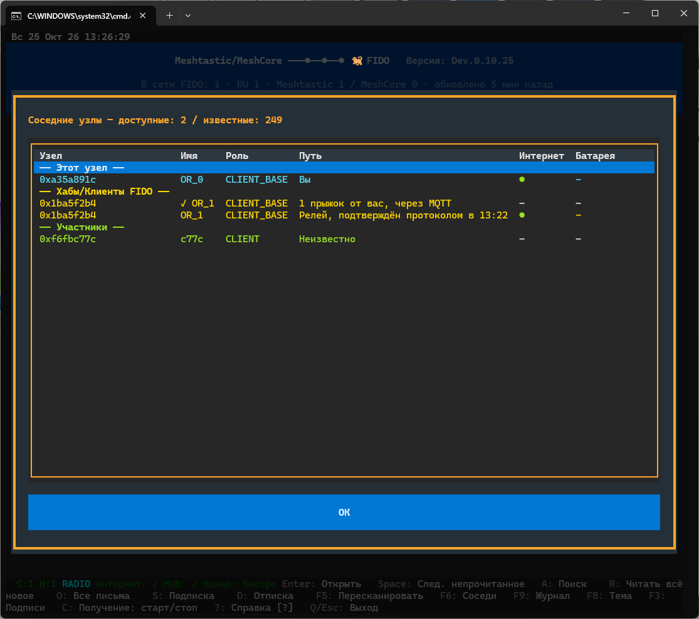

Экран «Соседние узлы» (клавиша `F6`): счётчик `доступные / известные` в заголовке, свой узел, группы «Хабы/Клиенты FIDO» и «Участники» (`CLIENT`/`CLIENT_MUTE`/`CLIENT_BASE`). Колонка «Путь» объединяет число хопов и способ связи («1 прыжок от вас, через MQTT», «Релей, подтверждён протоколом в 13:22», «Неизвестно»); далее — индикатор выхода в интернет и заряд батареи.

### 10. Журнал подключения (F9)

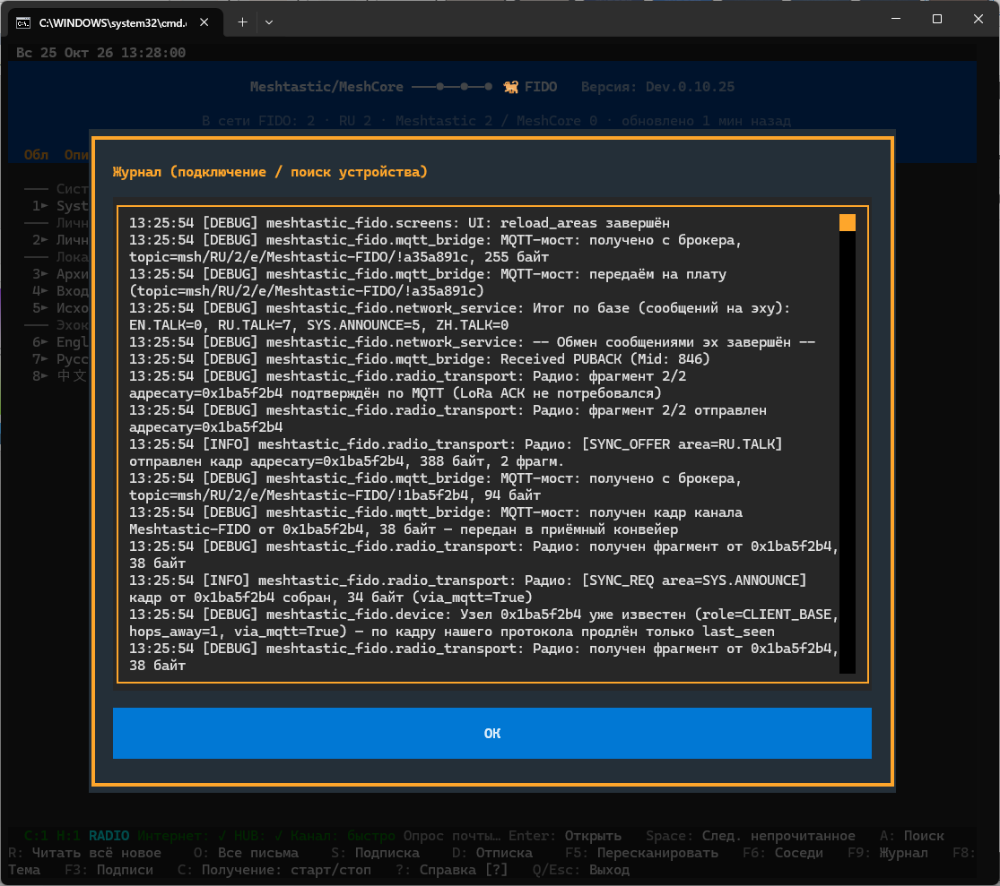

Диагностический журнал (клавиша `F9`): работа MQTT-моста (приём с брокера, передача на плату, `PUBACK`), отправка и сборка фрагментов кадров протокола (`SYNC_REQ`, `SYNC_OFFER`), подтверждение доставки по MQTT без LoRa ACK, итоги обмена по каждой эхе — всё на языке интерфейса.

### 11. Дерево переписки (Thread Tree)

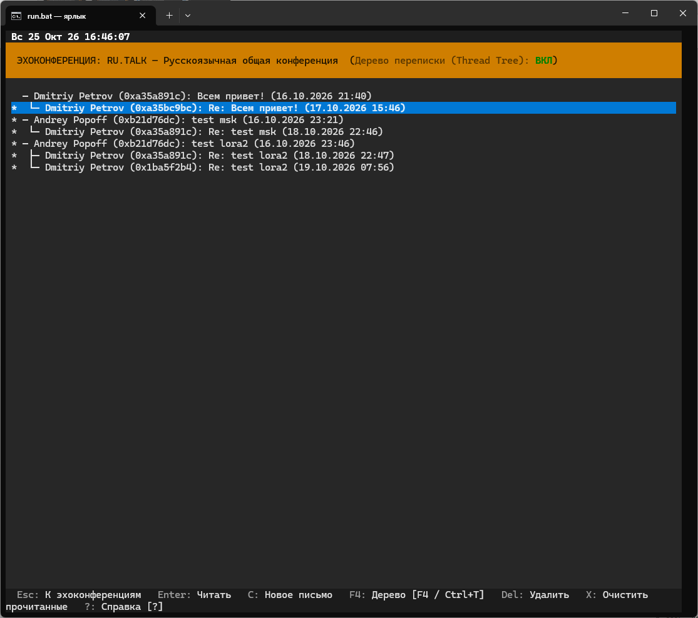

Список писем эхоконференции с включённым режимом «Дерево переписки» (`F4`/`Ctrl+T`): ответы визуально вложены под исходные письма, отдельные темы — самостоятельными ветками. Непрочитанные отмечены `*`.

### 12. Чтение письма — ответ

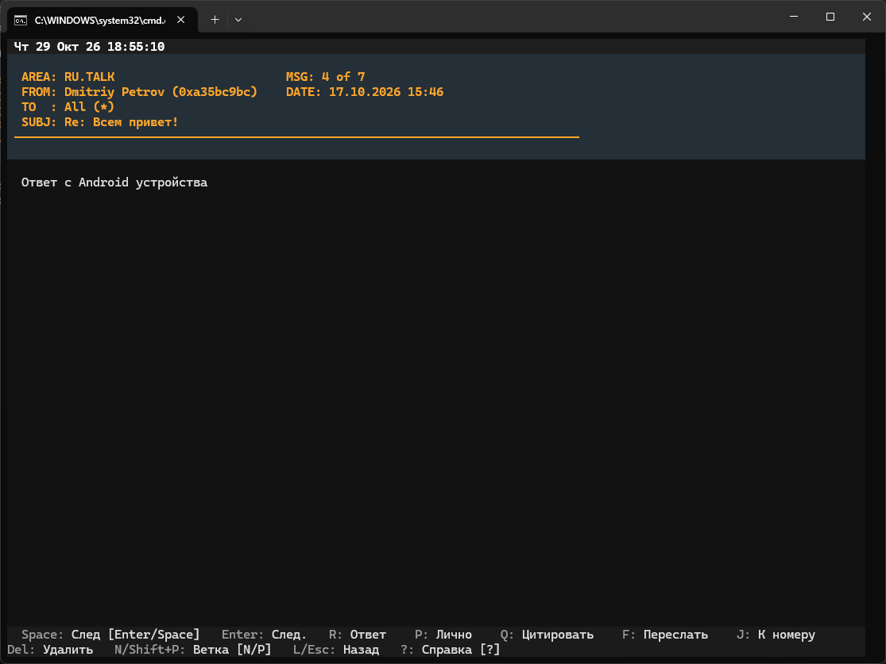

Чтение письма в эхоконференции `RU.TALK` (4 из 7): область, номер сообщения, отправитель с адресом узла, дата, получатель и тема в шапке, ниже — текст (здесь — ответ, отправленный с Android-клиента). Внизу — клавиши ответа (`R`), личного ответа (`P`), цитаты (`Q`), пересылки (`F`), перехода по ветке (`N`/`Shift+P`).

### 13. Написание нового письма в эхоконференцию

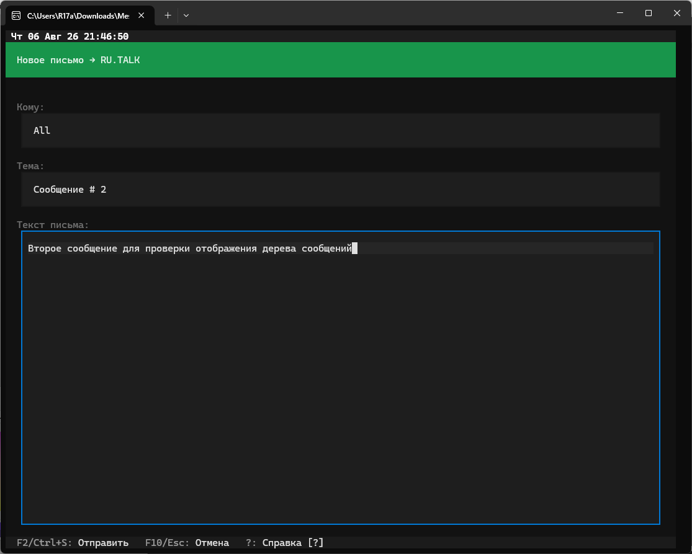

Встроенный редактор для нового письма в эхоконференцию `RU.TALK` — получатель, тема и текст сообщения. Отправка — `F2`/`Ctrl+S`, отмена — `F10`/`Esc`.

### 14. Встроенная справка — горячие клавиши (часть 1)

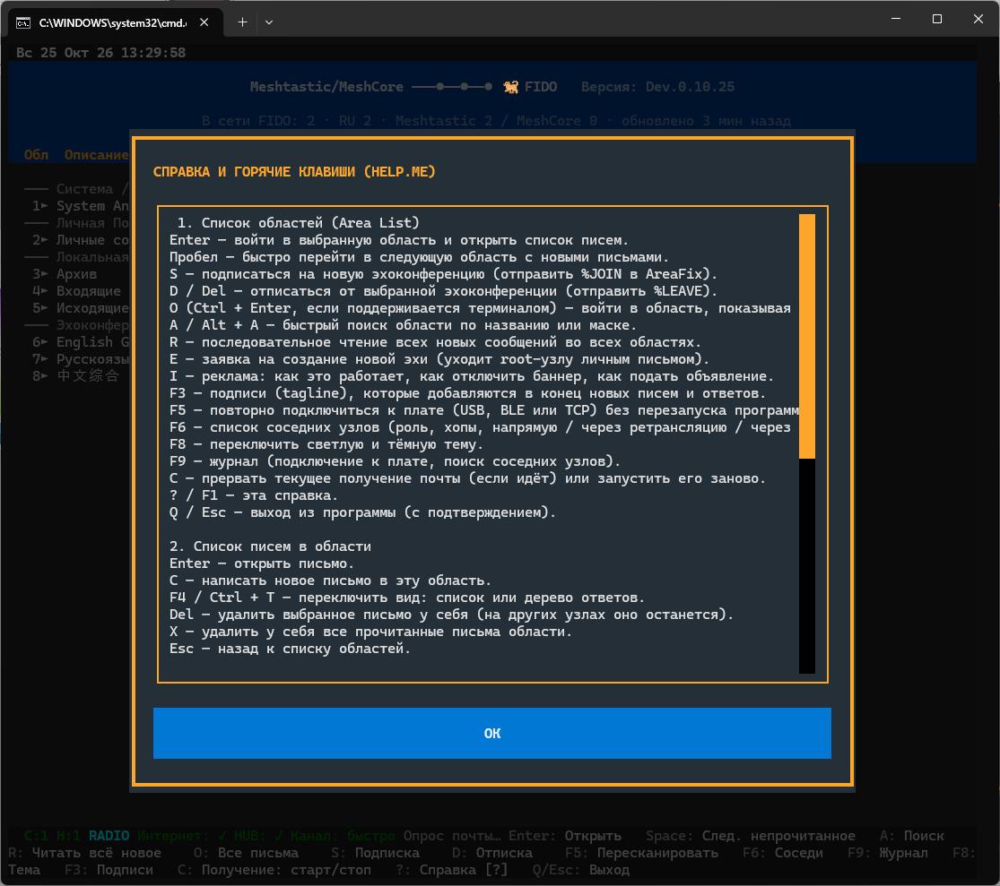

Встроенная справка по горячим клавишам (`?`/`F1`): навигация по списку областей (подписка `S`/`D`, поиск `A`, заявка на создание новой эхи `E`, реклама `I`, подписи `F3`, соседи `F6`, журнал `F9`, тема `F8`) и по списку писем области.

### 15. Встроенная справка — горячие клавиши (часть 2)

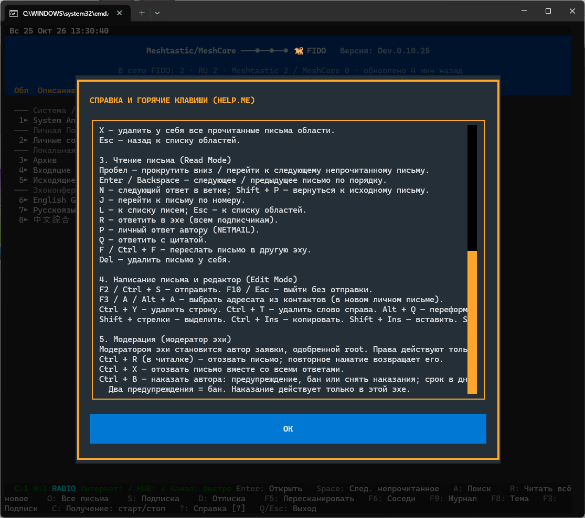

Продолжение справки: режим чтения письма, написание письма и команды встроенного редактора (выделение, буфер обмена, форматирование по лимитам FIDO), а также модерация эхи — отзыв письма (`Ctrl+R`/`Ctrl+X`) и наказание автора (`Ctrl+B`: предупреждение или бан в пределах этой эхи).
