# Meshtastic-FIDO — 界面演示

一个基于 Meshtastic（LoRa）的去中心化离线回声会议网络（风格类似 Fidonet/GoldED）。
以下是一次真实操作流程的截图序列：从首次启动到在回声会议中查看消息树。

---

### 1. 首次运行向导 — 用户信息与设备选择

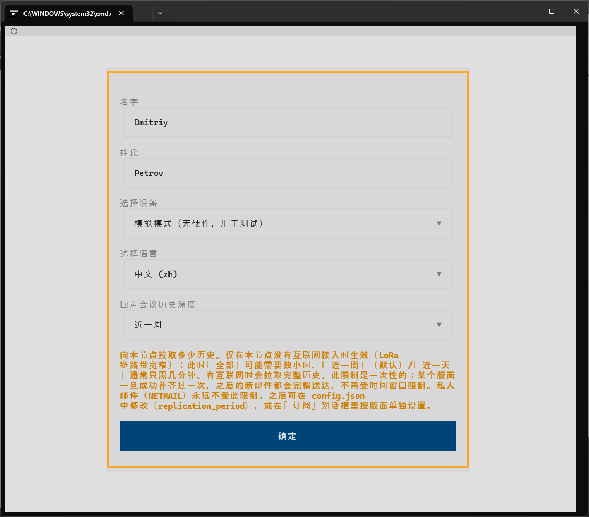

程序启动后的第一个界面：输入名字/姓氏，选择设备（默认选中 `Mock 模式`，无需硬件，用于测试）和界面语言。下方是“回声会议历史深度”：在没有互联网的节点上拉取多少旧邮件（`全部` / `一个月` / `一周` / `一天`）。该限制只生效一次——某个回声会议成功拉取一次后，之后会接收全部新邮件，与时间无关；个人邮件（`NETMAIL`）不受限制。以后可在 `config.json`（`replication_period`）中修改，或在“订阅”对话框中针对单个回声会议设置。

### 2. 选择连接方式

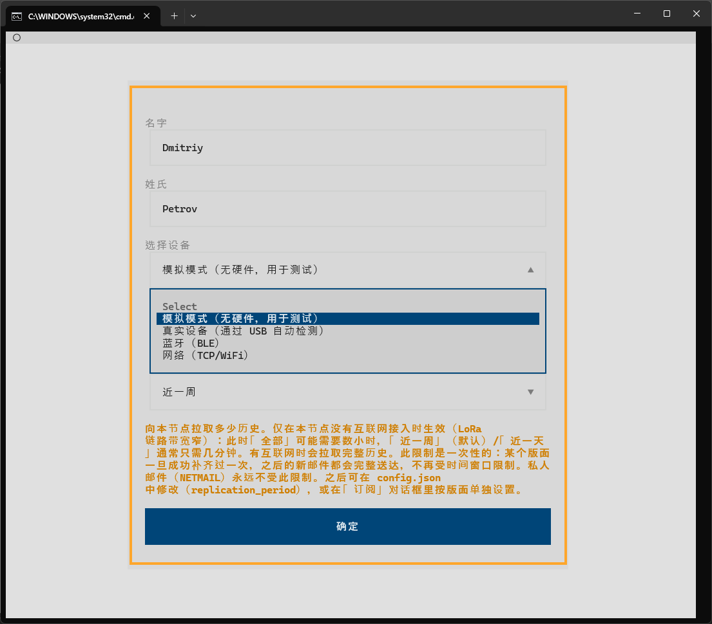

展开后的可用连接方式列表：`Mock 模式`（无需硬件，用于测试）、`真实设备`（通过 USB 自动检测）、`蓝牙 (BLE)` 以及 `网络 (TCP/WiFi)`。

### 3. 通过蓝牙 (BLE) 连接设备

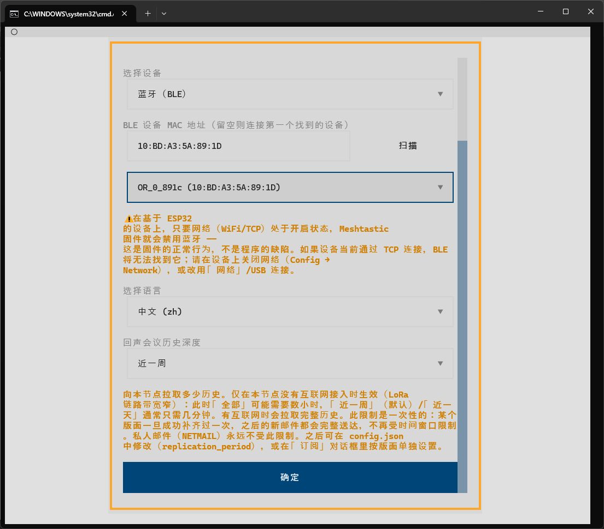

同一个向导，选中了 `蓝牙 (BLE)` 连接方式：扫描附近设备、通过 MAC 地址找到的开发板 `OR_0_891c`，以及一条提示——在 ESP32 芯片的开发板上，只要启用了网络（WiFi/TCP），Meshtastic 固件就会关闭蓝牙，这是开发板的正常行为，并非程序缺陷。

### 4. 网络守则 — 加入前需确认

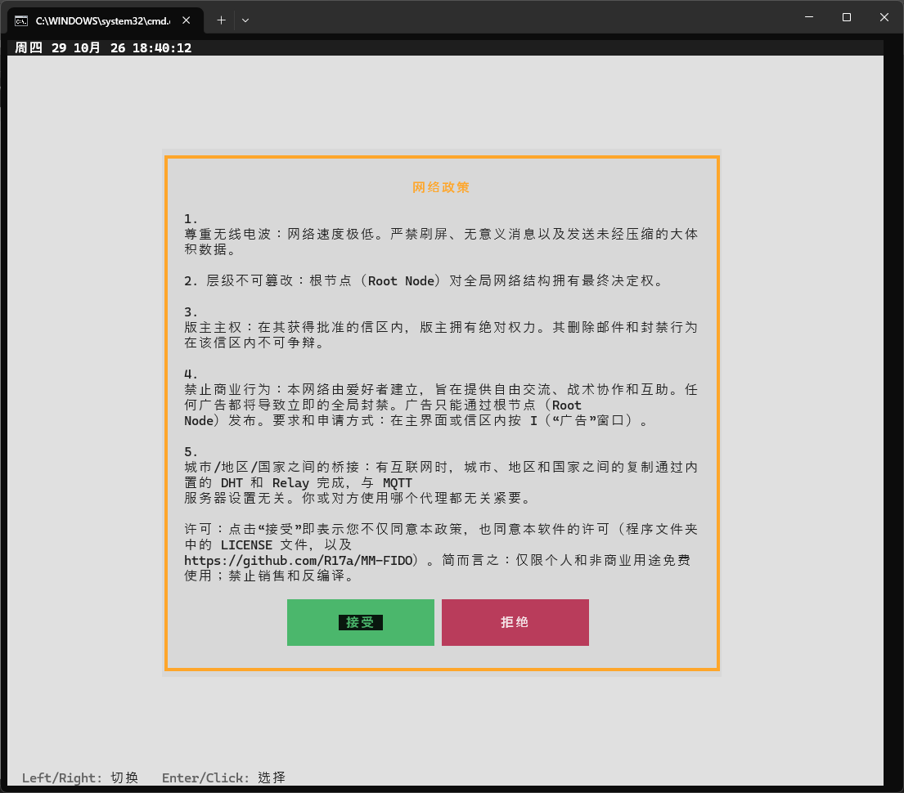

加入网络前，用户需查看并确认网络守则：尊重无线电空口资源、Root Node 层级结构不可更改、每个回声会议内版主拥有自主权、禁止商业行为（广告仅可通过 Root Node 投放；申请方式见 `I` 键），以及城市/地区/国家之间的桥接：有互联网时，复制通过内置的 DHT 和 Relay 进行，不依赖 MQTT 服务器设置。项目许可证与守则一并接受（全文位于窗口末尾）。

### 5. 主界面 — 分区列表

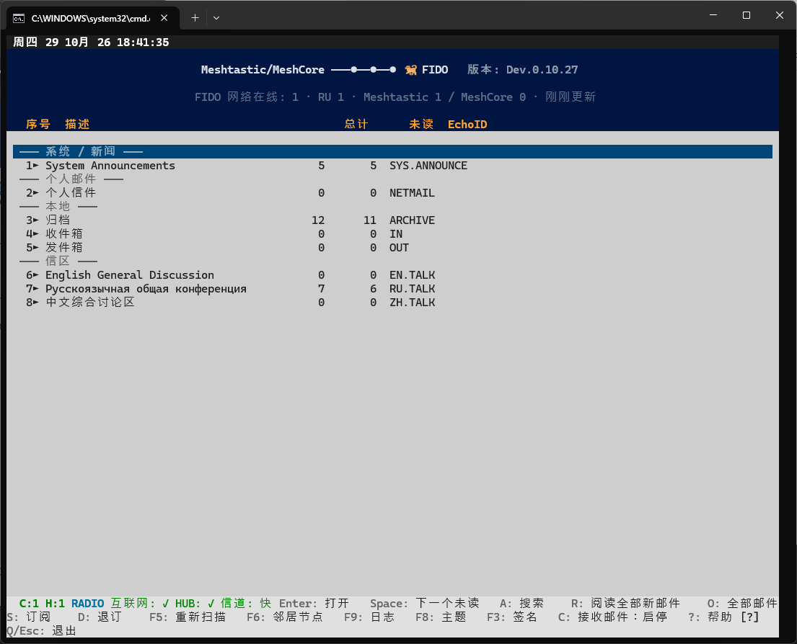
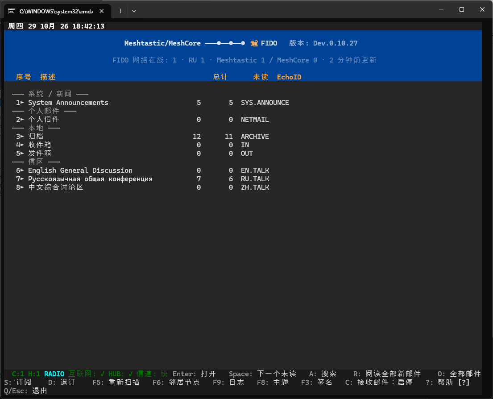

应用的主界面，采用 GoldED 风格：系统区 `SYS.ANNOUNCE`、个人邮件（`NETMAIL`）、本地文件夹（`ARCHIVE`/`IN`/`OUT`），以及初始的回声会议集合（`EN.TALK`、`RU.TALK`、`ZH.TALK`）。标题下方是网络概况（FIDO 网络节点数、Meshtastic/MeshCore 节点数、更新时间）；底部状态栏实时显示：`C:1 H:1`（附近客户端/中继）、`RADIO`、`互联网：✓`、`HUB：✓`、通道状态，下方是按键提示。第二张截图是按下 `F8` 键将浅色主题切换为深色主题后的同一界面。

### 6. 快速搜索回声会议（A）

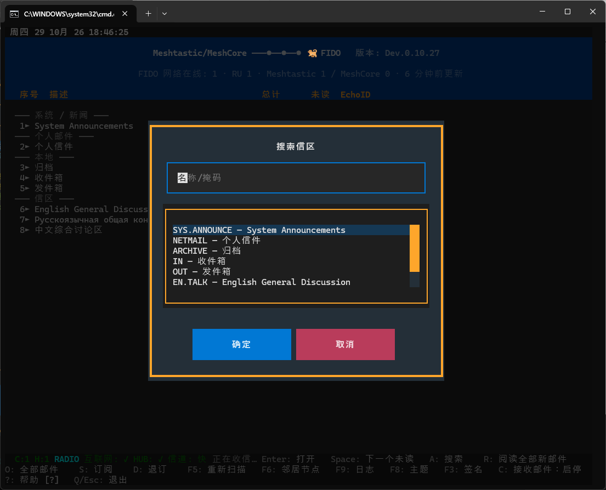

按 `A`（或 `Alt+A`）可按名称或掩码快速搜索分区：列表随输入缩小，点击 `确定` 进入所选分区。

### 7. 签名 — tagline（F3）

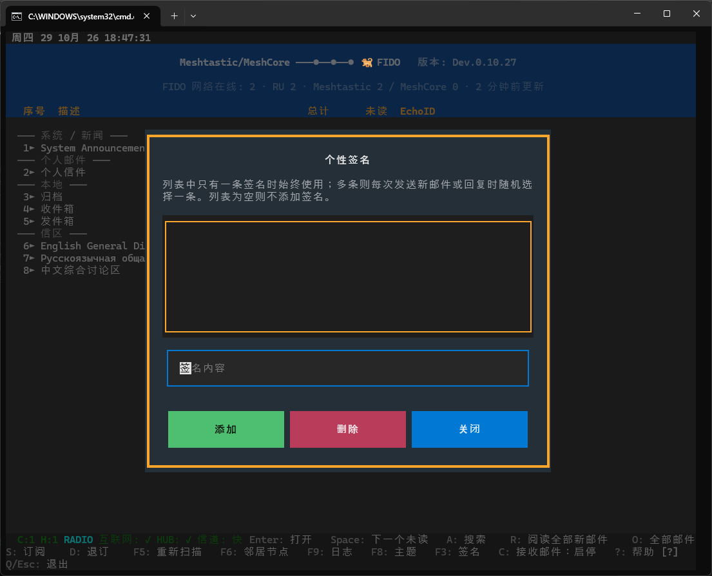

`F3` 键 — 管理附加在新邮件和回复末尾的签名。列表中只有一条签名时始终使用它；有多条时每次发送随机选取一条。列表为空则不添加签名。

### 8. 订阅回声会议（S）

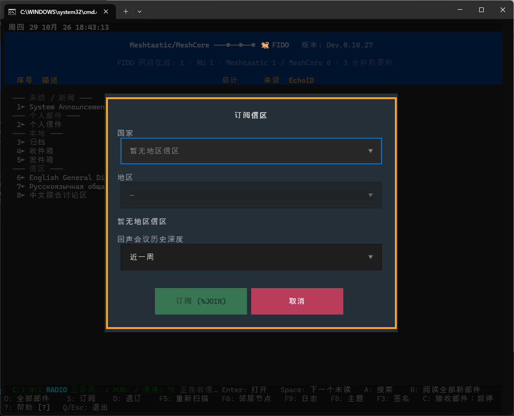

`S` 键 — 按国家和地区从共享目录中订阅回声会议，并可为该回声会议选择历史深度。“订阅 (%JOIN)”按钮会向中继发送请求（退订为 `D` 键，`%LEAVE`）。截图中目录里暂时还没有地区性回声会议，只有基础的 `RU/EN/ZH.TALK`。

### 9. 附近节点列表（F6）

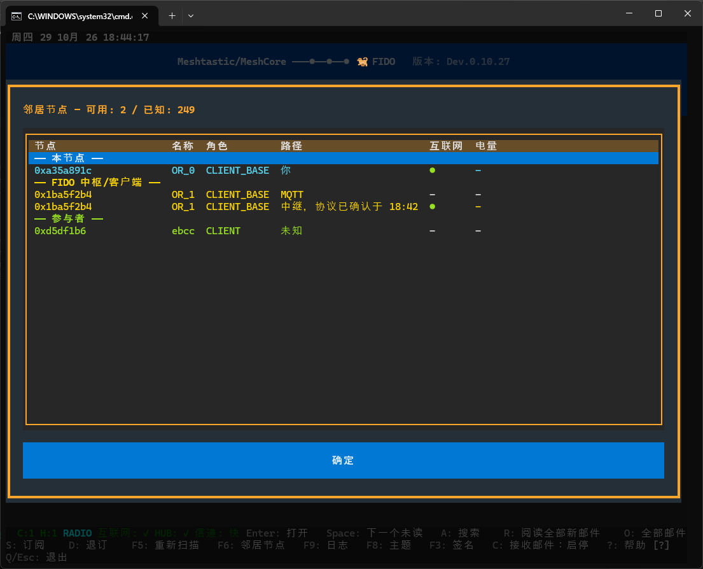

“附近节点”界面（`F6` 键）：标题栏中的 `可用 / 已知` 计数器、本机节点，以及“FIDO 中继/客户端”和“参与者”分组（`CLIENT`/`CLIENT_MUTE`/`CLIENT_BASE`）。“路径”列将跳数与连接方式合并显示（如“1 跳，经 MQTT”、“中继，协议确认于 13:22”、“未知”），其后是互联网指示灯和电量。

### 10. 连接日志（F9）

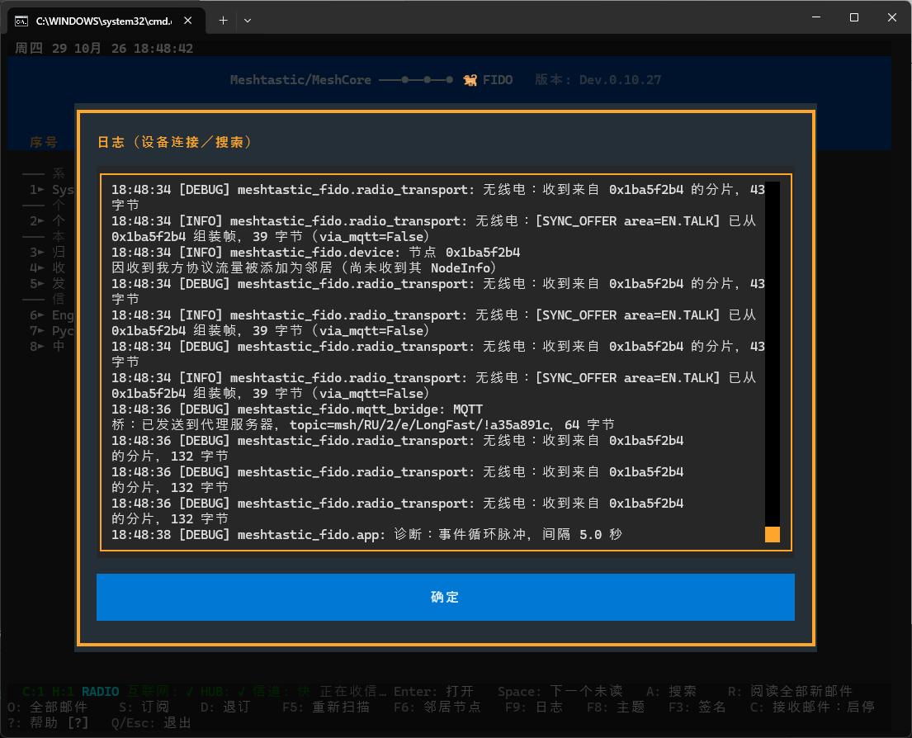

连接诊断日志（`F9` 键）：MQTT 桥接的工作情况（从代理接收、转发到设备、`PUBACK`）、协议帧分片的发送与重组（`SYNC_REQ`、`SYNC_OFFER`）、无需 LoRa ACK 即经 MQTT 确认送达，以及各回声会议的交换结果——全部以界面语言显示。

### 11. 消息树（Thread Tree）

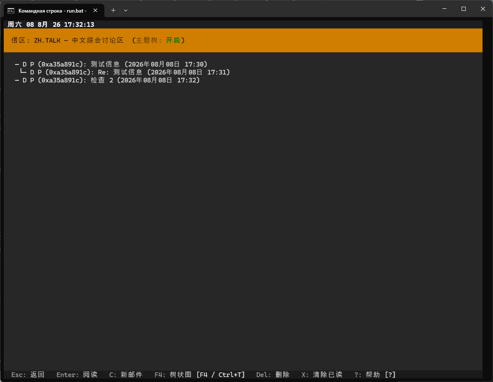

启用“消息树”（Thread Tree）模式（`F4`/`Ctrl+T`）后的回声会议消息列表——回复以视觉嵌套的方式显示在原始消息下方，无关的主题以独立分支显示。未读消息以 `*` 标记。

### 12. 阅读消息 — 带引用的回复

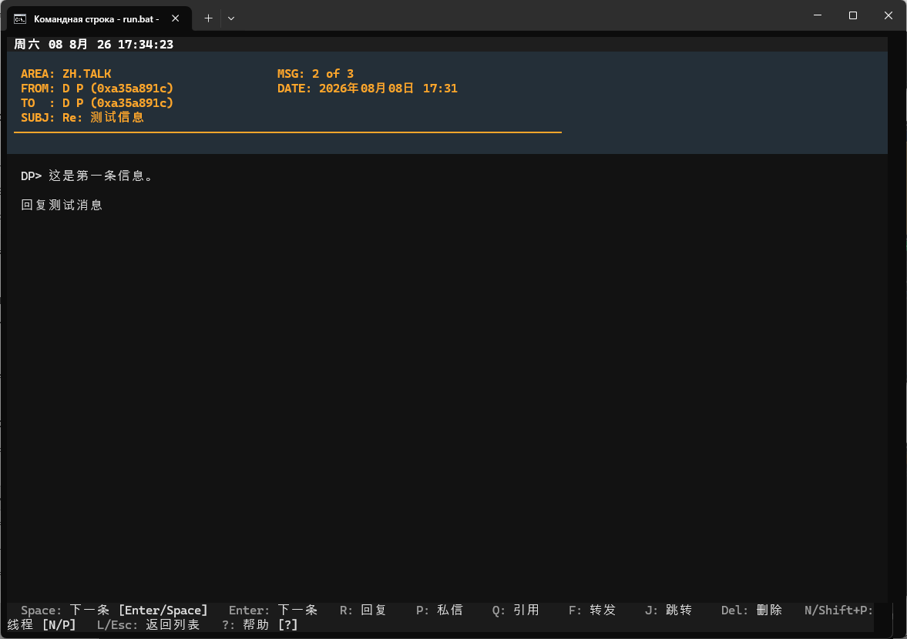

阅读 `ZH.TALK` 回声会议中的一条回复消息（该分区第 2/3 条）——标题栏显示分区、发件人、收件人、日期和主题，下方正文自动引用了原始消息。底部列出回复（`R`）、私信回复（`P`）、引用（`Q`）、转发（`F`）和线程导航（`N`/`Shift+P`）。

### 13. 在回声会议中撰写新消息

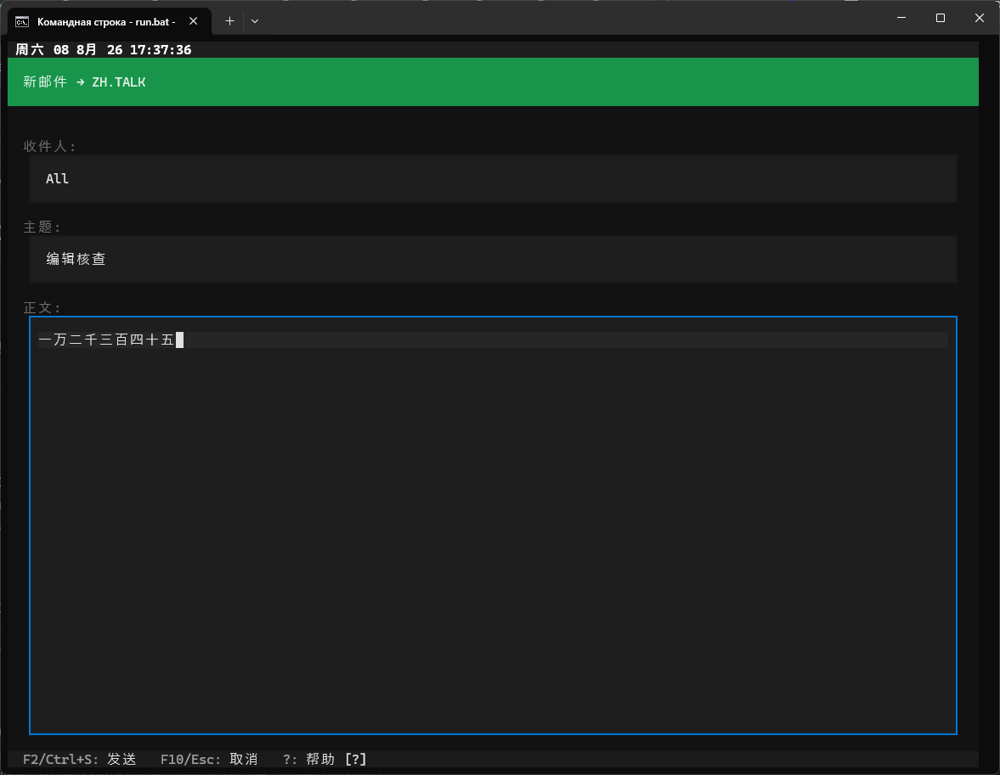

用于在 `ZH.TALK` 回声会议中撰写新消息的内置编辑器——收件人、主题和正文。发送为 `F2`/`Ctrl+S`，取消为 `F10`/`Esc`。

### 14. 内置帮助 — 快捷键（第一部分）

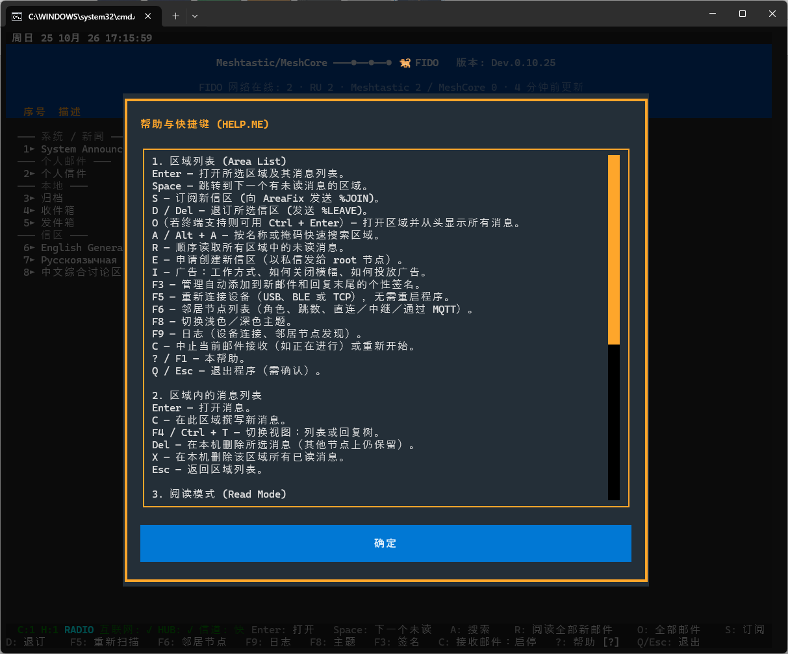

内置的快捷键帮助（按 `?`/`F1`）：分区列表的操作（订阅 `S`/`D`、搜索 `A`、申请创建新回声会议 `E`、广告 `I`、签名 `F3`、附近节点 `F6`、日志 `F9`、主题 `F8`）以及分区邮件列表的操作。

### 15. 内置帮助 — 快捷键（第二部分）

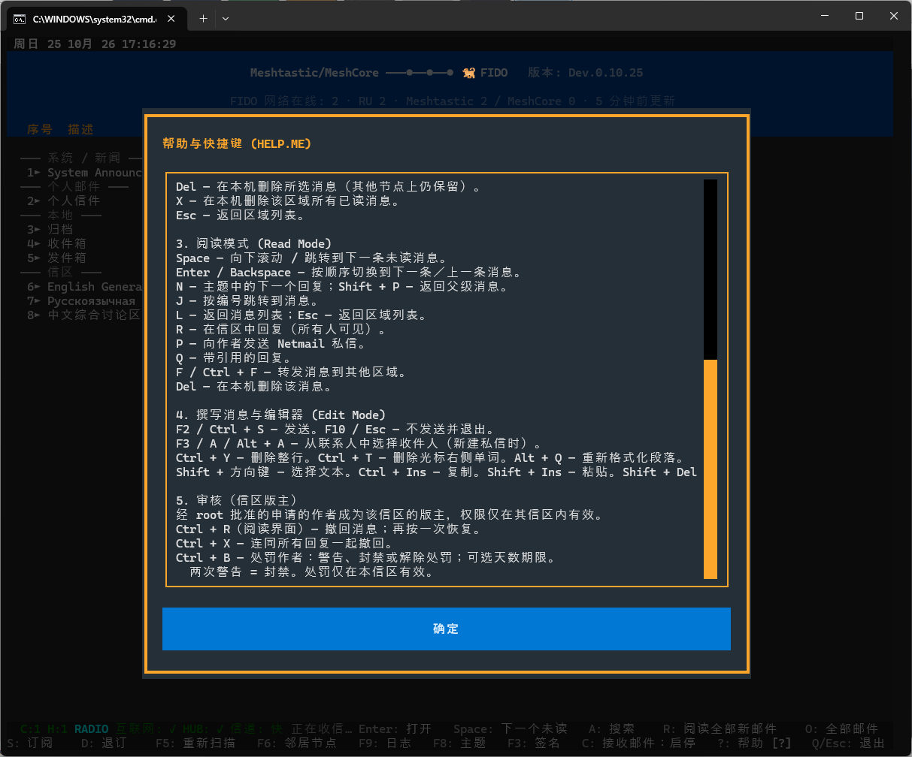

帮助内容的后续部分：消息阅读模式、撰写消息以及内置文本编辑器的命令（选择、剪贴板、按 FIDO 限制格式化文本），还有回声会议管理——撤回消息（`Ctrl+R`/`Ctrl+X`）和处罚作者（`Ctrl+B`：在该回声会议内警告或封禁）。
